# Chronicle: a simpler layout, phone first

**A proposal. Nothing in the app has changed.** The mockups are a static page beside the app, and no
code changes until Evan approves.

The brief, from Evan: Chronicle works, but too many options are in view and he has to hunt for
things. Keep every function. Put the main actions up front, tuck the rarely used ones into menus or
sheets, show fewer controls at once, and design for the phone first.

## How it was measured

- **Phone:** 375×812 with touch, in the Browser pane, on the dev preview's data. A timer is running
  unless a row says otherwise.
- **Controls:** every visible button, link, field, toggle and tab in the room or its open dialog.
  Anything inside a closed fold is not counted. The live room and the mockups were counted by the same
  probe.
- **Screens tall:** how many phone screens the room takes, top to bottom.
- **Mockups:** [mockups.html](2026-11-13-chronicle-layout/mockups.html). It uses the site's own
  stylesheet, so the screens look like the room. Every control on it is inert. Open it through the
  dev server, for example `/docs/2026-11-13-chronicle-layout/mockups.html#aims`. The screens are
  `#day #day-idle #start #now-menu #aims #aims-row #journal #friends #stop`.

## Before and after, at a glance (375)

| Screen                  | Controls now | Mockup                               | Screens tall now | Mockup |
| ----------------------- | ------------ | ------------------------------------ | ---------------- | ------ |
| Aims → Today            | 49           | 21                                   | 2.1              | 0.7    |
| Day, timer running      | 31           | 18                                   | 2.3              | 1.0    |
| Day, nothing running    | 35           | 21                                   | 2.4              | 1.1    |
| Journal                 | 21           | 13                                   | 1.4              | 0.9    |
| Friends                 | 19           | 7                                    | 1.7              | 0.6    |
| The dialog after ■ Stop | 20           | 8, with the other 12 behind **More** |                  |        |

Two figures say more than the totals:

- **Aims → Today shows 2 goals** on the first screen now. The mockup shows all 4 open goals and the
  Done fold.
- **Day shows 3 of the day's 6 sittings** on the first screen now. The mockup shows 5.

The mockups are shorter partly because they fold things: the week grid, done goals and the sharing
settings. That is the proposal. Everything folded is one tap away.

At wider sizes the room today has about the same totals: 53 controls on Aims → Today, 35 on Day, 23 on
Journal and 21 on Friends, at both 820 and 1440 with nothing running.

## The changes, screen by screen

Each one keeps the function it moves. Where something leaves the screen, it says where it goes.

### On every tab

1. **The timer becomes one slim bar.** It holds the clock, the name, the time left, **■ Stop** and
   **⋯**. The ⋯ sheet holds ✎ Note, Switch to (the same chips) and ＋ New activity. Today the timer
   card is 226px tall on every tab of a phone, with four "switch to" chips. The bar is 67px.
2. **The four tabs fit.** At 375 today, "Aims 4" is cut to "Ai…" because the count pushes the label
   out. This one is a bug as well as clutter.

| Day, now                                                                                   | Day, mockup                                                                               | The bar's ⋯ sheet                                                                                                |
| ------------------------------------------------------------------------------------------ | ----------------------------------------------------------------------------------------- | ---------------------------------------------------------------------------------------------------------------- |
| 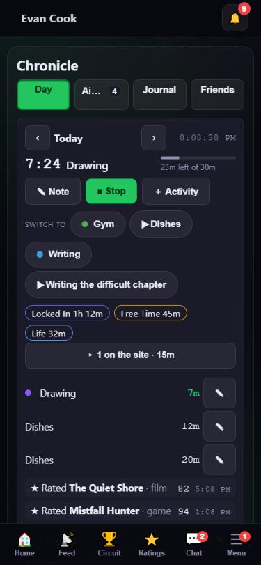 | 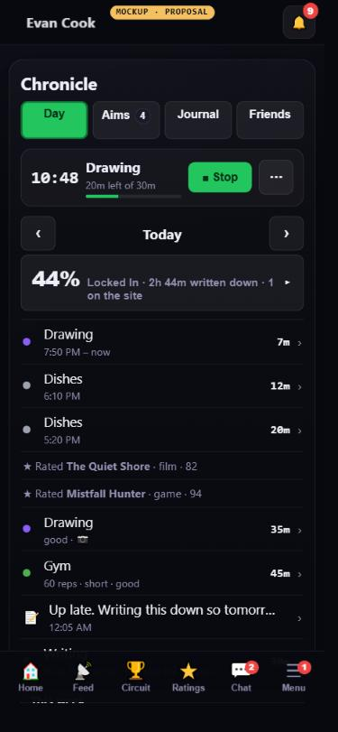 | 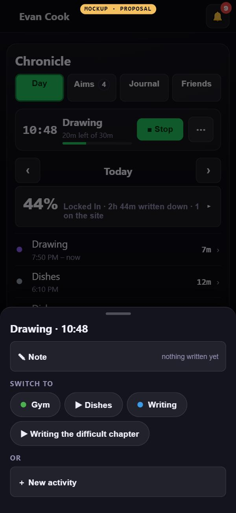 |

### Day

3. **The day's headline moves to the top.** One line reads "44% Locked In · 2h 44m written down · 1
   on the site ▸". Today that summary (the rail) is the last block on a phone, 1,680px down.
   Tapping the line opens the rest of the rail (Focused, how much of the day is covered, Coming up),
   the category totals and the list of what was on the site.
4. **A sitting's row is its own button.** Tapping the row opens the same editor that ✎ opens today,
   and a › says so. That takes away the separate 34px ✎ beside every row.
5. **The week grid folds** into "This week ▸ 7% of these 6 days is written down", which opens the
   same grid. Today the grid is 481px tall on a phone.
6. **Planned, Routines and Activities share one row,** "Plans, routines and activities ▸", which
   opens a sheet holding all three. They are already folds, so this only groups them.
7. **With nothing running, one button starts something.** **▶ Start something** sits beside a ⋯,
   with the three most recent activities as chips under it. The sheet holds everything that sits on
   screen today:
   - the "What are you doing?" picker;
   - every activity;
   - 🕘 Log a past session (today's Live / Log past switch);
   - ✎ Write a note;
   - ＋ New activity.

   That is eleven controls today and five in the mockup.

| Nothing running, now                                                                                          | Mockup                                                                                                        | The Start sheet                                                                                         |
| ------------------------------------------------------------------------------------------------------------- | ------------------------------------------------------------------------------------------------------------- | ------------------------------------------------------------------------------------------------------- |
| 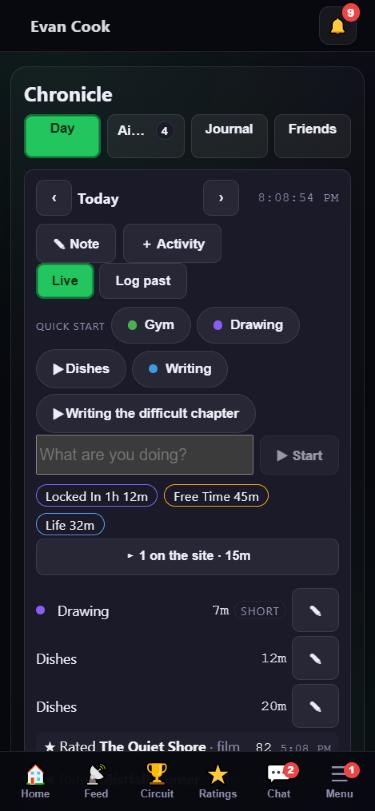 | 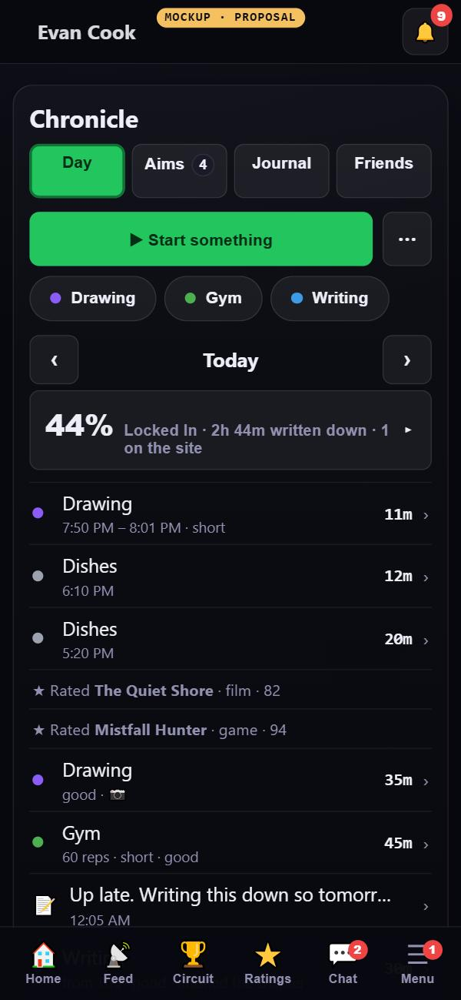 | 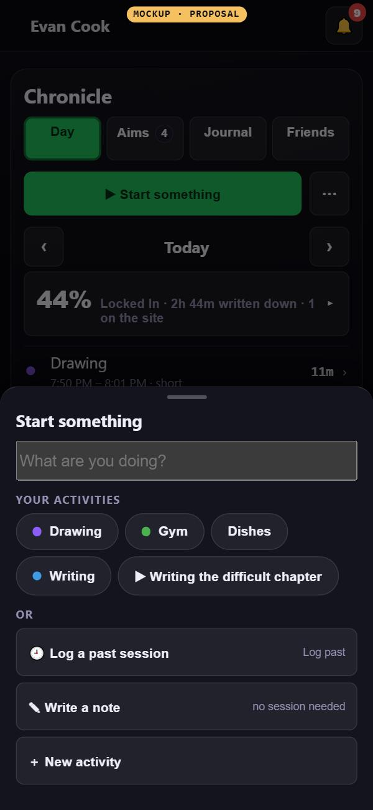 |

### Aims

8. **Each goal gets one ⋯** instead of ✎ ○ ✕ on a line of their own. The ⋯ sheet holds Change, On
   your profile (and for whom), and Delete. The things done every day stay on the row: the tick, −
   and + on a counted goal, and ▶ on a goal that counts an activity.
9. **The horizons become Today · Tomorrow · Week · More ▾.** This month, This year and Years move
   into the menu, with their counts. Today all six sit in a strip that scrolls sideways.
10. **＋ Add sits at the top,** beside the date. Today it is at the foot of the list.
11. **Done goals fold** into "Done today · 4 ▸".

| Aims → Today, now                                                                            | Mockup                                                                                       | A goal's ⋯ sheet                                                                                          |
| -------------------------------------------------------------------------------------------- | -------------------------------------------------------------------------------------------- | --------------------------------------------------------------------------------------------------------- |
| 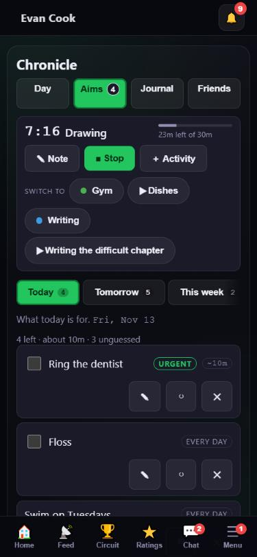 | 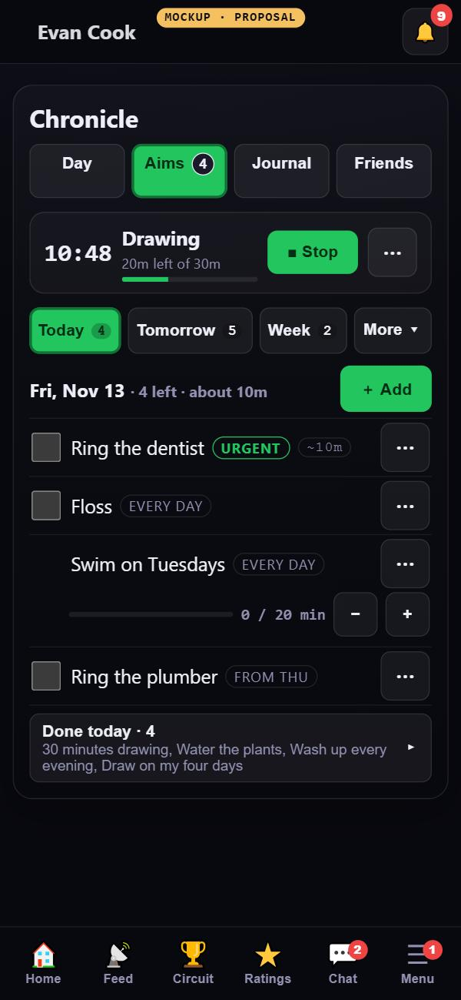 | 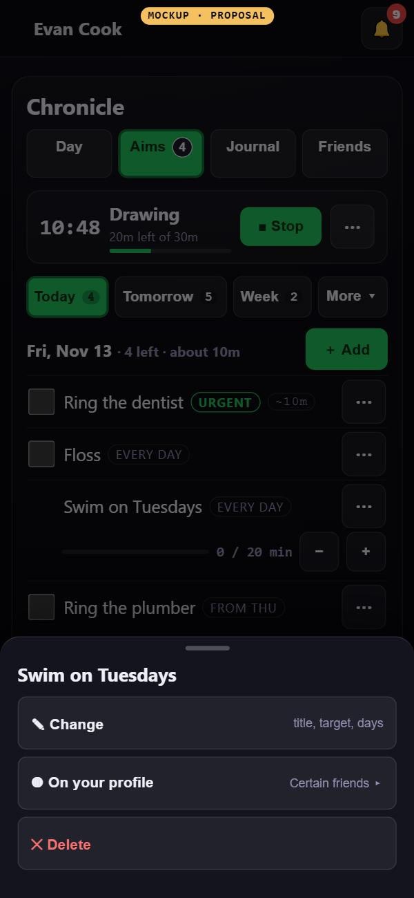 |

### Journal

12. **Writing comes first, and search sits behind 🔍.** Today the search box comes before the box you
    write in.

### Friends

13. **The feed comes first.** The sharing settings move behind one row: "Sharing is on · 1 activity
    and 3 goals · who sees what ▸". Today the switch, the activity list and the goals list all come
    before the first friend's entry, which starts 1,010px down.
    **When sharing is off, the switch stays on screen,** above an empty feed. That is the reason
    Chronicle.tsx gives for the settings sitting first: the empty screen has to be able to turn
    sharing on. It still holds.

| Journal, now                                                                               | Journal, mockup                                                                                   | Friends, now                                                                               | Friends, mockup                                                                                   |
| ------------------------------------------------------------------------------------------ | ------------------------------------------------------------------------------------------------- | ------------------------------------------------------------------------------------------ | ------------------------------------------------------------------------------------------------- |
| 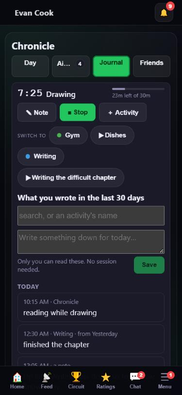 | 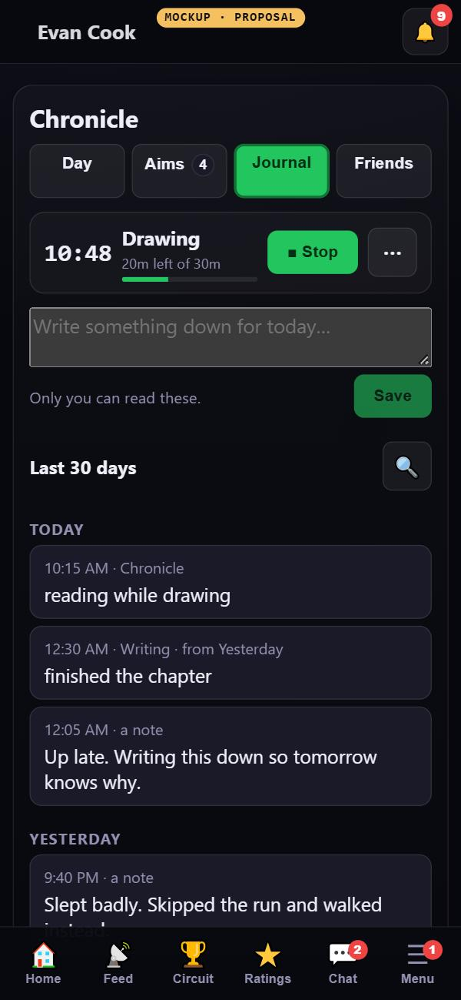 | 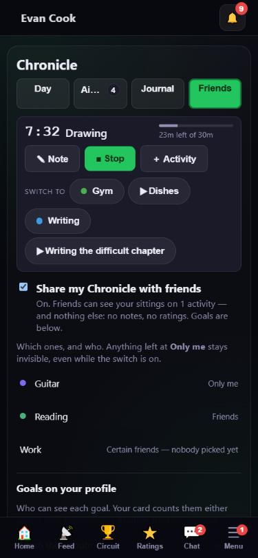 | 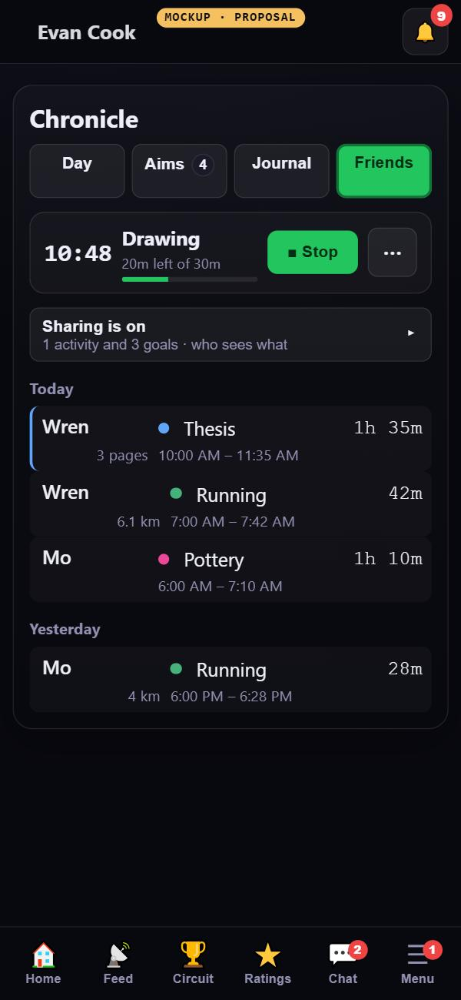 |

### After ■ Stop

14. **"How did it go?" comes first.** The sheet shows the five ratings, a note box and **Done**.
    **More** opens what is on the dialog today: the activity, the times, the count, the photo
    buttons and Delete.
    **Done would save what you picked,** because there is no Save beside it. Today, Done closes
    without saving edits and Save saves them. Nothing is lost by merging the two: with nothing
    changed, Done just closes, as it does now.

| After Stop, now                                                                                        | Mockup                                                                                                |
| ------------------------------------------------------------------------------------------------------ | ----------------------------------------------------------------------------------------------------- |
| 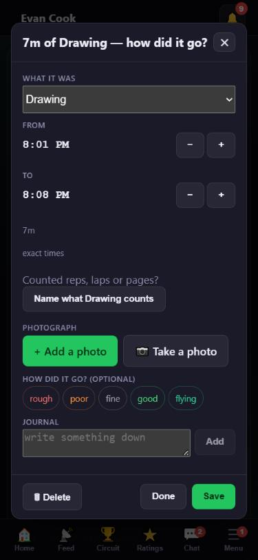 | 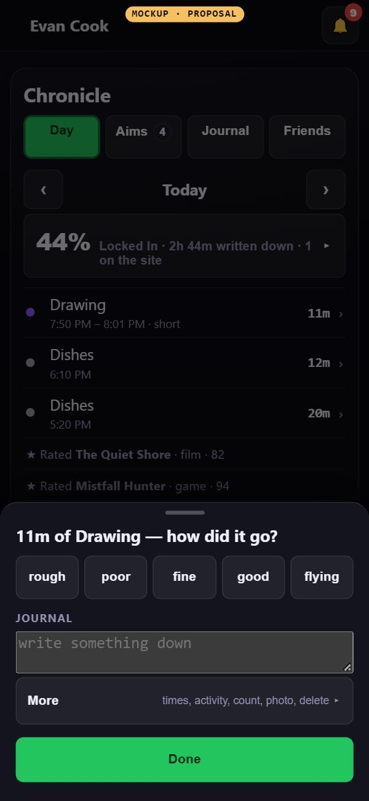 |

## Wider screens

The structure stays the same. From 900px the summary stays the side rail it is today, and the week
grid can start open, because there is room. The row ⋯ stays at every size, because a control that
only appears on hover does not exist on a tablet.

## Questions for Evan

1. **Fold done goals by default?** Some people like seeing them struck through.
2. **Start the week grid folded on a phone?** It is the Day screen's biggest block, and it is a
   picture of the week rather than something you act on.
3. **Three most recent activities on the idle Day, or ones you pin?**
4. **Months, Years and the year behind More ▾,** or all six horizons in view as today?
5. **One Done after Stop,** saving the rating and note, instead of Done and Save side by side?

## What this would take

No database change and no new dependency: every move is a change of layout and which component draws
what. It would land as one draft per screen in the order above, with a before-and-after check of each
one in the pane at 375, 820 and 1440, because every function moves rather than disappears.

## Not checked

A real phone. Firefox and Safari. The mockups were measured in the Browser pane only.
