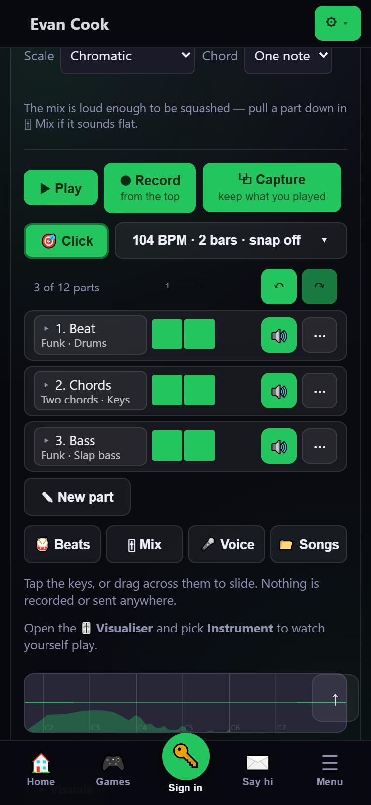
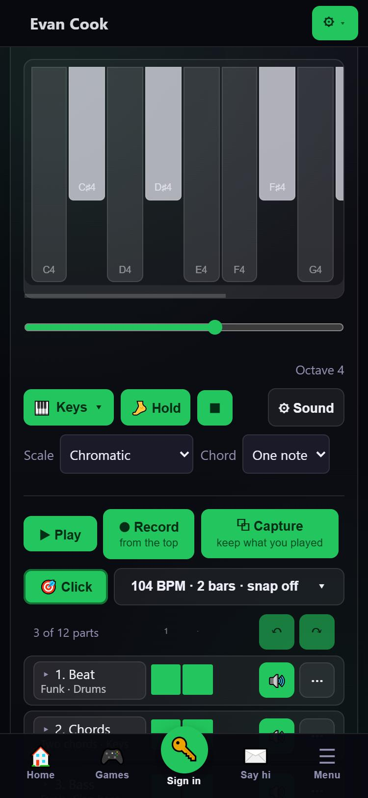
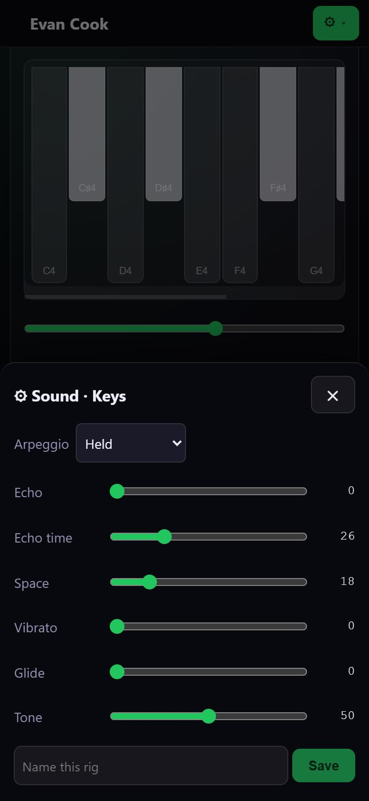
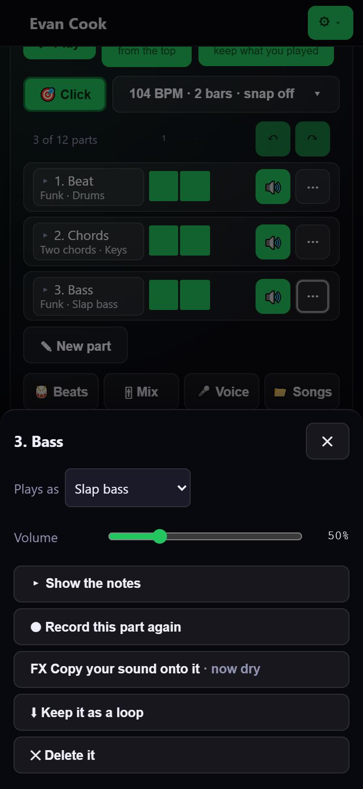
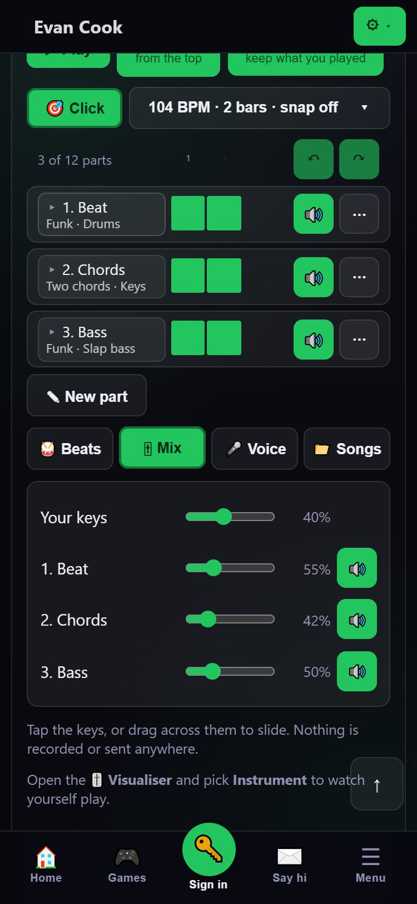
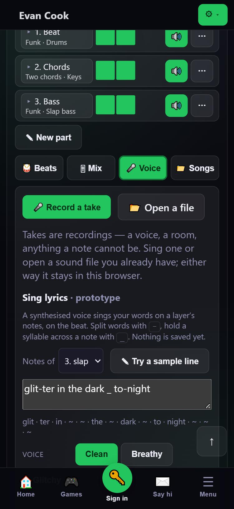
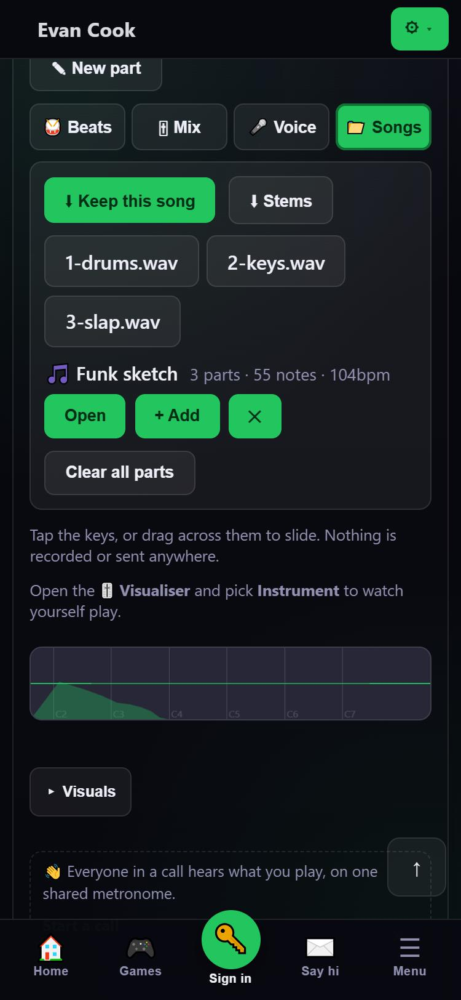
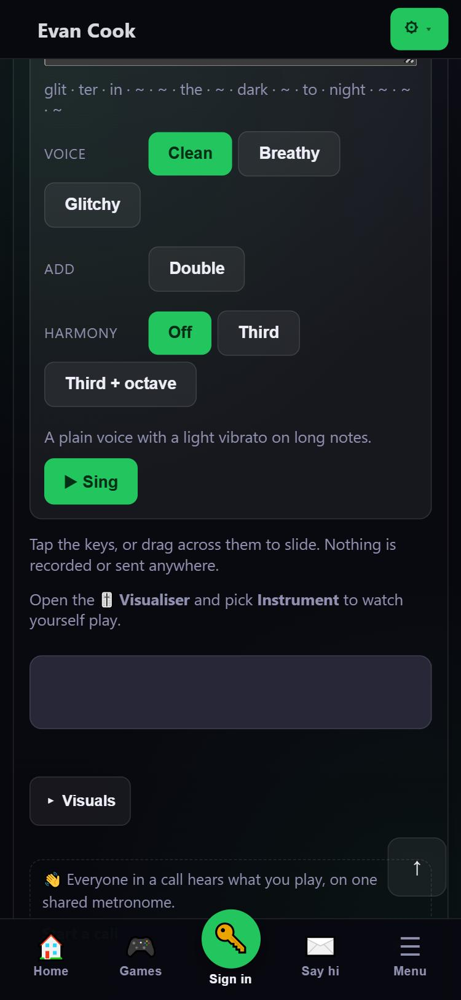
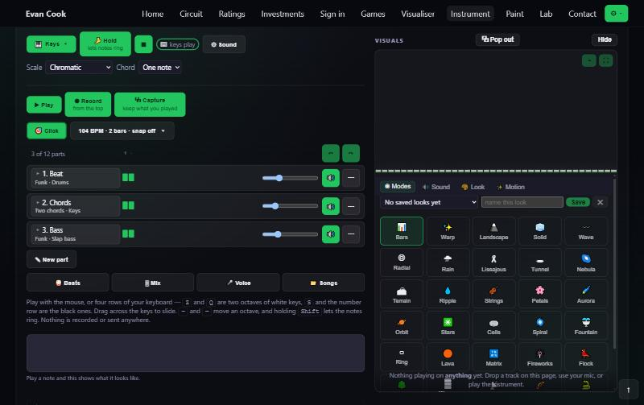

# Instrument: the #311 layout, built

The proposal is [#311](https://github.com/justanothertree/yaya/pull/311)
(`docs/2026-11-14-instrument-layout.md` on its branch), with Evan's five answers of 14 Nov 2026.
This is the room built to it: no database change, no new dependency, and every control still
reachable. Where the build differs from the proposal, the reason is below.

## Four places

1. **Play.** Under the keys, two rows on a phone and one on a desktop: 🎹 Keys ▾, 🦶 Hold, ⏹
   (Panic), ⚙ Sound, then Scale, Key and Chord. Octave − and + are gone from the bar; the strip
   above the keys sets the same octave, "Octave 4" is printed at the end of the chord line, and −
   and = still move it. Volume moved to 🎚 Mix (and the floating player keeps its own).
   ⚙ Sound is a sheet with the arpeggio, the six knobs and the rigs.
2. **The song.** ▶ Play, ⏺ Record and ⧉ Capture; then 🎯 Click and one button reading
   "104 BPM · 2 bars · snap off ▾", which opens a sheet with BPM, Bars and Snap. The bar ruler
   carries the part count and ↶ ↷. A part is one line: its name (tap it for the notes, as before),
   its bars, 🔊 and ⋯. The ⋯ sheet has Plays as, Volume, Show the notes, Record this part again,
   Copy your sound onto it, Split, Keep it as a loop and Delete. ✎ New part is under the parts.
3. **Four tools, one open at a time:** 🥁 Beats (the beats and chords panel, unchanged), 🎚 Mix
   (your keys, each part's volume and mute, each take's mute), 🎤 Voice (the takes and Sing lyrics)
   and 📁 Songs (⬇ Keep this song, ⬇ Stems, the kept songs and Clear all parts).
4. **Below, unchanged:** the help line, the scope, ▸ Visuals and the call note.

**A closed tool stays mounted, only hidden** — the condition one-at-a-time was approved on.
Measured: with a line singing, opening 🎚 Mix left the singer with 1 live voice and 🎤 Voice
showing a dot; leaving the room took it to 0. `useTakes` is called once, in `SongTools`, because
its takes are in Voice and its Stems in Songs, and two calls would be two recorders.

## Measured, before and after

The same probe on both, on the same day: `main` (53adeda) served from a scratch checkout on :5190
and this branch on :5181, each with the room's own keys cleared from localStorage first. The song
is a fresh room, then 🥁 Pick a style → **Funk** (three parts), stopped, with the tool closed.
Controls are every visible button, link, field, slider and toggle in the room, with the keyboard's
own keys left out and anything closed or hidden not counted (`checkVisibility()`).

| Screen                                | `main`                 | This branch       | Mockup |
| ------------------------------------- | ---------------------- | ----------------- | ------ |
| Phone (375), first visit: controls    | 36                     | **25**            | 26     |
| ↳ screens tall                        | 2.41                   | **1.82**          | 1.5    |
| ↳ ▶ Play starts at                   | 776px                  | **684px**         | 598px  |
| Phone, three parts: controls          | 68                     | **39**            | 39     |
| ↳ screens tall                        | 2.79                   | **1.75**          | 1.6    |
| ↳ first part starts at                | 1,456px                | **826px**         | 738px  |
| Desktop (1440), first visit: controls | 51, plus 45 in Visuals | **26**, plus 45   | 26     |
| Desktop, three parts, Visuals hidden  | 82                     | **42**            | 42     |
| ↳ screens tall                        | 2.16                   | **1.64**          | 1.4    |
| ↳ ▶ Play / first part                | 826px / 1,186px        | **723px / 877px** |        |

The counts land on the mockup's. The heights do not quite, for two reasons the mockup did not
have: the room's real health line ("The mix is loud enough to be squashed…") shows for the Funk
starter, and ⏺ Record and ⧉ Capture keep their second lines (see below).

## Where it differs from the proposal, and why

- **Record and Capture keep their second line** ("from the top", "keep what you played"). The
  mockup drew none. They are the one place on screen that tells the three ways of keeping
  something apart (item 2 of the 11 Nov flow map), and "tap to cancel" is the only word saying a
  second press throws the pass away. Hold's ("lets notes ring") stays on a desktop and is hidden
  on a phone, where it pushed ⚙ Sound onto a line of its own.
- **✎ New part shows on a first visit too.** The mockup hid it until there was a part, which
  would have made drawing your first part impossible without playing one first.
- **The 🎶 Jam link survives the call note being put away.** It moved into the note as proposed,
  but the link was added on 12 Nov precisely because that note is dismissible. Once it is
  dismissed, one line stays in its place: "🎶 Jam with friends — start a call in Chat…"
  (`AlsoTogether`'s new `whenGone`).
- **The ruler's row appears when there is a part or something to undo**, as undo did before; the
  mockup showed two dead buttons on a first visit.
- **A take has a mute in Mix and no volume.** A take has never had a volume control; the loop plays
  it at its stored gain and nothing sets it. Adding one is a feature, not a move, so it is not here.
- **The bars of every part, and the ruler, scroll together.** New, and needed by the one-line
  part: on a phone about three bars fit beside the name, so a longer song scrolls inside the row,
  and rows scrolling one at a time would put one part's bar 5 under another's bar 1. Measured at
  375 with 32 bars: one row scrolled 200px moved every row and the ruler to 200, and bar 9 sat at
  x=213 in all three rows and under ruler mark 9. A rearranged part, whose strip ends in an "all"
  button, still reaches it.
- **A tool opened below the screen is scrolled up to.** The beats panel did this for itself when
  it mounted; mounted from the start and only hidden, it would never have run again, so the check
  moved to `SongTools` and now covers all four (measured: Beats opened from the top of the page
  landed with its top 72px down).
- **⚙ Sound is no longer remembered open.** A fold left open is part of the page; a sheet left
  open would cover the room on your next visit.
- **🎤 Voice wears a dot** while a take records or a line sings with the tool closed, because the
  button that stops either is inside it.

Copy this made untrue, and fixed: the health line said "pull a layer's volume down" (on a phone
that is in 🎚 Mix now), and the Profile's song block told people to press "Keep song", which is
"⬇ Keep this song" inside 📁 Songs.

**The kept-songs list is styled for the first time.** It never had a rule, from the day it was
added (63833b09, 31 Aug): a browser bullet, "Funk sketch3 parts" run together, and Open, + Add and ✕
touching. Nothing overflowed and nothing was under 24px, so `mobileAudit` passed it; the Songs
screenshot below is what showed it. The words take one line and the three buttons the next on a
phone, and they share one line at 1440.

## Screens

Taken in the pane at 375 (touch) and 1440, with the Funk starter's three parts. The desktop capture
is 800px wide because the pane scales a 1440 page down to fit.

| The room's top                                                                                                                                                    | ⚙ Sound                                                                                                                                             | A part's ⋯                                                                                                                                                                                   |
| ----------------------------------------------------------------------------------------------------------------------------------------------------------------- | ---------------------------------------------------------------------------------------------------------------------------------------------------- | -------------------------------------------------------------------------------------------------------------------------------------------------------------------------------------------- |
|  |  |  |

| 🎚 Mix                                                                                                                                             | 🎤 Voice                                                                                                                                 | 📁 Songs                                                                                                                                                           |
| -------------------------------------------------------------------------------------------------------------------------------------------------- | ---------------------------------------------------------------------------------------------------------------------------------------- | ------------------------------------------------------------------------------------------------------------------------------------------------------------------ |
|  |  |  |

**🎤 Voice, lower down** — retaken on 14 Nov 2026 after main brought in the Sing panel's new sound
(#338): its Harmony row is now Off / Third / Third + octave, starting on Off.

## How it was checked

- **Every control was driven in the pane at 375 with touch:** both sheets' Escape, backdrop and
  focus return; the keys still playing under ⚙ Sound; BPM typed for real (120 BPM on the button)
  and snap 1/8; Plays as, Volume, Copy FX, Show the notes (and undo standing down while the notes
  are open), Record this part again (count-in, the row marked, cancel), Split and its undo, Keep it
  as a loop, Delete and its undo; Mix's keys, part and mute writing the same values the rows show;
  Keep this song, Open, Add, Clear all parts and Undo; space, − and =; 12 of 12 parts (New part
  and Beats go dead, and the reason is on screen); the drum kit; the jam doorway.
- **`mobileAudit`** at 375 (touch) with the room, each tool and each sheet open: no sideways
  scroll, nothing past an edge, clipped, spilling, unnamed or under 24px — after it first named a
  planted 16px button. At 820 with the `(pointer: coarse)` rules injected: clean. At 1440 with a
  mouse it flagged one new thing, the sheet's and the row's volume sliders at 16px tall, fixed to
  24; what it still lists there (the keyboard strip, the ruler and bar cells, the call note's link)
  `main` lists identically.
- **Reduced motion:** the sheets' one animation, a fade, runs only under `no-preference`, and the
  site's own switch takes it to 1ms.
- **Tab** walks the room top to bottom with no jump back up, and stays inside an open sheet.
- **Gates:** `npm run typecheck`, `npm run lint`, `npm run test`, `npm run build`. New tests:
  `partName.test.ts` (what a one-line part says) and `tempoFace.test.ts` (the button reads all
  three values).

## Not checked

A real phone, Firefox and Safari. A microphone take recording while 🎤 Voice is closed (the pane
has no microphone; the same mounted-and-hidden rule that kept the singer singing applies). The
Jam row inside a call, whose code did not change.
