# Instrument: fewer, clearer panels (proposal)

**A proposal. Nothing in the app has changed.** The mockups are a static page beside the app. No code
changes until Evan approves.

The brief, from Evan: group the keyboard, sound, volume, song and vocal controls into fewer, clearer
panels, with advanced options tucked away. Lose no function. Count the controls visible on each
screen before and after.

## How it was measured

- **Phone:** 375×812 with touch, in the Browser pane. **Desktop:** 1440×900, mouse.
- **The song:** a fresh room, then 🥁 Pick a style → **Funk**, which makes three parts (a beat, two
  chords and a slap bass), stopped.
- **Controls:** every visible button, link, field, slider and toggle in the room. The keyboard's own
  keys are left out of every figure, because they are the instrument rather than a control
  (13 at 375, 25 at 1440, in both versions). Anything inside a closed fold is not counted. The live
  room and the mockups were counted by the same probe.
- **Screens tall:** from the top of the room's card to its last line, in screen heights.
- **▶ Play:** how far down the room ▶ Play starts. On a phone, the site's header and bottom bar
  leave about 690px of room on screen.
- **Mockups:** [mockups.html](2026-11-14-instrument-layout/mockups.html), built from the room's own
  stylesheet and its own key, button and bar-cell styles. Every control on it is inert. Open it
  through the dev server, for example
  `/docs/2026-11-14-instrument-layout/mockups.html#song`. The screens are
  `#first #song #sound #tempo #layer #mix #voice #songs`.

## Before and after, at a glance

| Screen                         | Controls now           | Mockup | Screens tall now | Mockup | ▶ Play starts now | Mockup |
| ------------------------------ | ---------------------- | ------ | ---------------- | ------ | ------------------ | ------ |
| Phone, first visit             | 34                     | 26     | 2.4              | 1.5    | 711px              | 598px  |
| Phone, a song with three parts | 67                     | 39     | 2.8              | 1.6    | 763px              | 598px  |
| Desktop, first visit           | 50, plus 45 in Visuals | 26     |                  | 1.2    | 753px              | 593px  |
| Desktop, three parts           | 81                     | 42     | 2.1              | 1.4    | 742px              | 593px  |

Three figures say more than the totals:

- **On a phone, ▶ Play is below the screen today.** It starts at 763px, under the bottom bar, so
  the keys and ▶ Play are never on screen together. In the mockup the keys, ▶ Play, ⏺ Record and
  ⧉ Capture are all on the first screen.
- **On a phone, the first part starts 1,415px down today,** almost two screens below the keys. In the
  mockup it starts at 738px: the whole song (the sound bar, the transport, all three parts and the
  tools) fits on one screen.
- **On a desktop the instrument menu starts open today** (14 of the 50 and 81), and a fresh visit
  opens the Visuals with 45 more. The mockup starts with the menu folded, as a phone does. The Visuals
  are unchanged.

Opening a panel, on a phone with the song loaded:

| Opened                    | Now                                                 | Mockup                                                                       |
| ------------------------- | --------------------------------------------------- | ---------------------------------------------------------------------------- |
| ⚙ More sound / ⚙ Sound  | +9 under the bar; ▶ Play moves from 763 to 1,179px | 11 in a sheet; nothing on the page moves                                     |
| 🎤 Sing lyrics / 🎤 Voice | +9                                                  | +11, which includes 🎤 Record a take and 📂 Open a file (always shown today) |
| 🥁 Beats & chords         | +40, above the parts                                | the same panel, +40, under the parts so they stay where they are             |
| 📁 Library / 📁 Songs     | +3 a song                                           | +3 (Keep, Stems, Clear all, which are always shown today) and +3 a song      |
| A part's ⋯                | (no menu; everything is on the row)                 | 9 in a sheet                                                                 |
| 🎚 Mix                    | (no mixer; volumes are scattered)                   | +7: your keys, then each part's volume and mute                              |
| Speed, length and snap    | (always shown: 6)                                   | 7 in a sheet                                                                 |

## The proposal: four places

### 1. Play: the keys, and two rows under them

| Now (phone)                                                                                               | Mockup                                                                                                    |
| --------------------------------------------------------------------------------------------------------- | --------------------------------------------------------------------------------------------------------- |
| 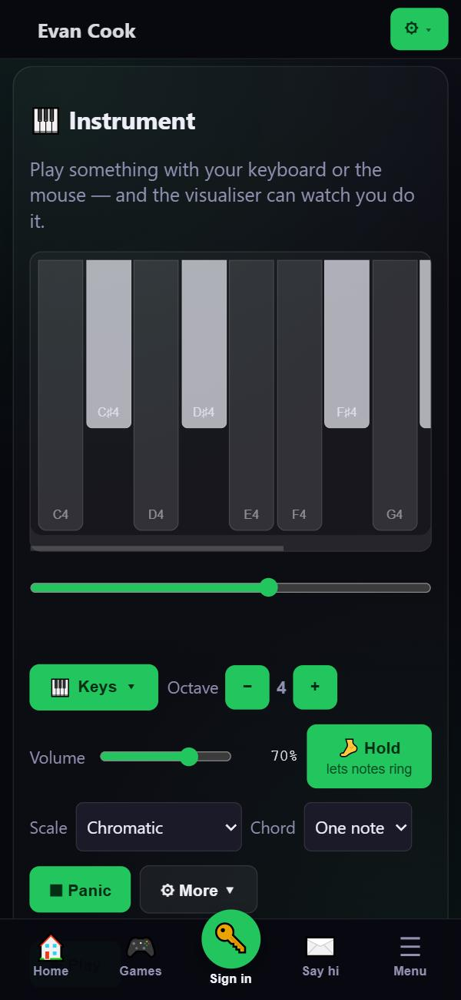 | 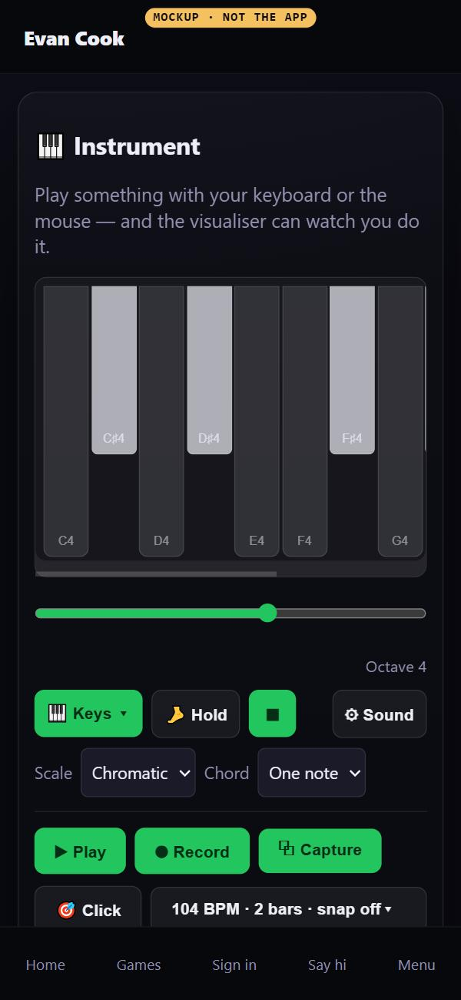 |

1. **Two rows instead of four.** Row one: **🎹 Keys ▾**, **🦶 Hold**, **⏹** (Panic) and
   **⚙ Sound**. Row two: **Scale**, **Key** and **Chord**, which stay beside your hands, as Evan
   asked on 10 Nov.
2. **Octave − and + leave the bar.** The strip under the keys sets the same octave (it is the same
   number in the code), and "Octave 4" is printed at its end. On a computer, − and = still move it.
3. **Volume moves to 🎚 Mix.** It is also on the floating "You're playing" player, as it is today.
4. **⚙ Sound** opens a sheet with what used to unfold under the bar: Arpeggio, Feel, Arrives, Echo,
   Echo time, Space, Vibrato, Glide, Tone, and the saved rigs. These are the settings you choose once
   and leave.

| ⚙ Sound, now                                                                                | ⚙ Sound, mockup                                                                           |
| -------------------------------------------------------------------------------------------- | ------------------------------------------------------------------------------------------ |
| 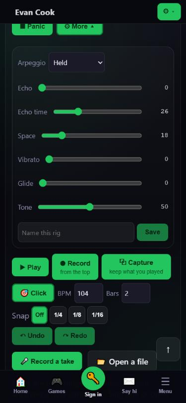 | 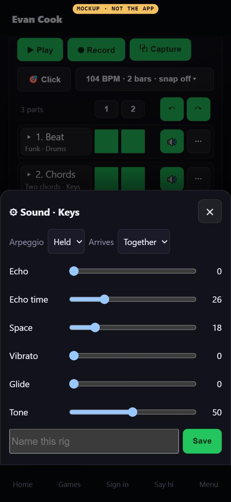 |

### 2. The song: transport, then the parts

5. **Row one is what you press while making a song:** ▶ Play, ⏺ Record and ⧉ Capture.
6. **Row two:** 🎯 Click, and one button that reads **104 BPM · 2 bars · snap off ▾**. It opens a
   small sheet with BPM, Bars and Snap. They are set once a song and read often, so the button shows
   all three.
7. **↶ Undo and ↷ Redo sit on the bar ruler,** beside the parts they undo.
8. **A part is one line:** its name (tap it to see the notes, as today), its bars, 🔊 mute and **⋯**.
   The ⋯ sheet holds "Plays as" (the instrument), Volume, Show the notes, Record this part again,
   Copy your sound onto it, Split, Keep it as a loop, and Delete. Today all of those sit on the row,
   which is 113px tall on a phone; in the mockup a row is 55px.
9. **✎ New part** sits under the parts.
10. **On a first visit,** the room's three steps (How fast?, Pick a style, Capture) take the parts'
    place, as they do today.

| The song, now (two screens)                                                                                                                                                             | Mockup (one screen)                                                                              |
| --------------------------------------------------------------------------------------------------------------------------------------------------------------------------------------- | ------------------------------------------------------------------------------------------------ |
| 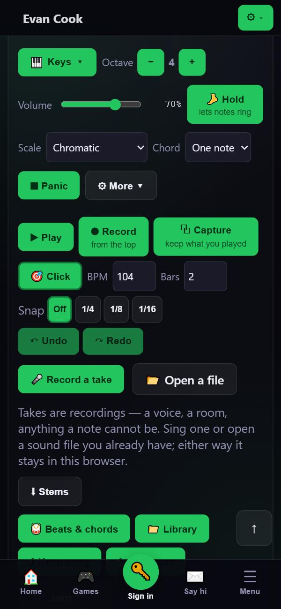 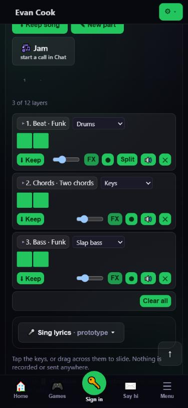 | 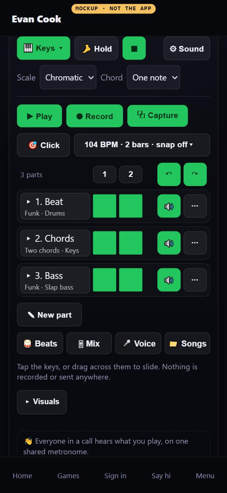 |

| A part's ⋯                                                                                |
| ----------------------------------------------------------------------------------------- |
| 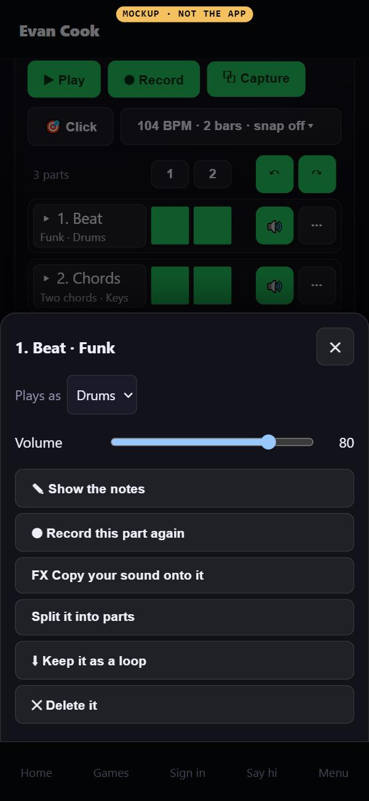 |

### 3. Four tools under the song, one open at a time

11. **🥁 Beats** is today's 🥁 Beats & chords panel, unchanged.
12. **🎚 Mix** puts every volume in one place: your keys, then each part's volume and mute (and each
    take's, when there are takes). Today they are in three places: the bar, each part's row and the
    floating player.
13. **🎤 Voice** puts the vocal tools together: 🎤 Record a take, 📂 Open a file, the takes, and
    Sing lyrics (prototype). Today the take buttons are always on screen in the middle of the song,
    and Sing lyrics is a separate fold further down.
14. **📁 Songs** puts keeping and opening together: ⬇ Keep this song, ⬇ Stems, the kept songs (Open,
    Add, ✕) and Clear all parts. Today ⬇ Keep song and 📁 Library are separate buttons, ⬇ Stems is
    with the takes, and Clear all is under the parts.

| 🎚 Mix                                                                       | 🎤 Voice                                                                         | 📁 Songs                                                                         |
| ---------------------------------------------------------------------------- | -------------------------------------------------------------------------------- | -------------------------------------------------------------------------------- |
| 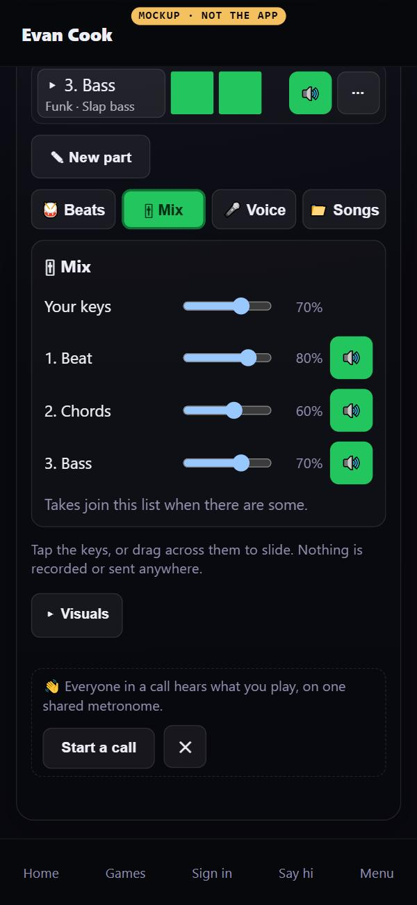 | 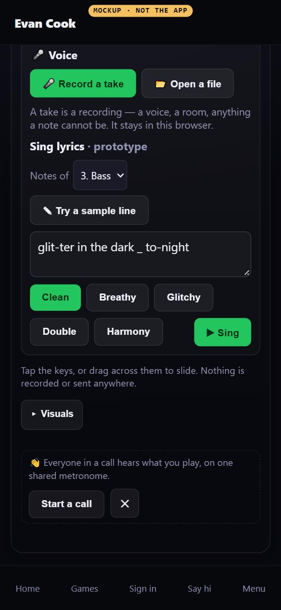 | 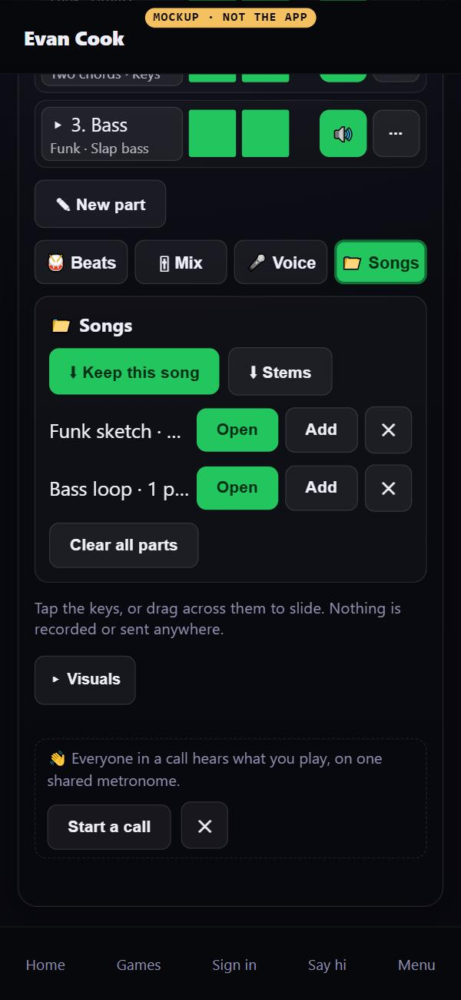 |

| Sing lyrics, now                                                                             |
| -------------------------------------------------------------------------------------------- |
| 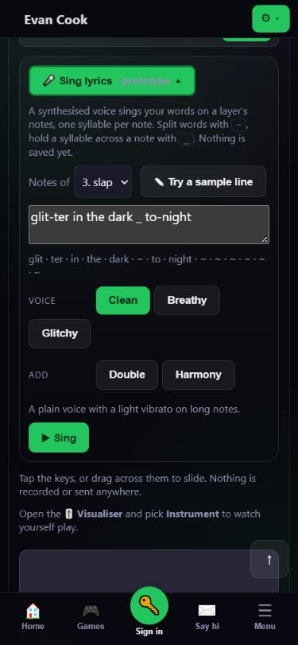 |

### 4. Below: unchanged

The help sentence, the scope, ▸ Visuals and the "Everyone in a call hears what you play" note stay
as they are. So do the piano roll, the floating player, the audio health line and the Jam row in a
call.

## Where everything goes

Every control in the room today, and where it is in the proposal.

| Today                                                                              | Proposal                                                                   |
| ---------------------------------------------------------------------------------- | -------------------------------------------------------------------------- |
| Keys, the slide strip                                                              | Unchanged                                                                  |
| 🎹 Instrument ▾ (kinds, then instruments)                                          | Unchanged; starts folded on a desktop too                                  |
| Octave − / +                                                                       | The strip under the keys (same octave), "Octave 4" beside it, − and = keys |
| Volume                                                                             | 🎚 Mix → Your keys, and the floating player                                |
| ⌨ keys play / keys off (desktop)                                                  | Unchanged                                                                  |
| 🦶 Hold, ⏹ Panic, Scale, Key, Chord                                               | Play bar                                                                   |
| ⚙ More sound: Arpeggio, Feel, Arrives, six knobs, Name this rig, Save, saved rigs | ⚙ Sound sheet                                                             |
| ▶ Play, ⏺ Record, ⧉ Capture                                                      | Song, row one                                                              |
| 🎯 Click                                                                           | Song, row two                                                              |
| BPM, Bars, Snap Off / 1/4 / 1/8 / 1/16                                             | The "104 BPM · 2 bars · snap off ▾" sheet                                  |
| ↶ Undo, ↷ Redo                                                                     | The bar ruler                                                              |
| First-visit steps (Slow, Steady, Upbeat, Fast, Pick a style)                       | Unchanged                                                                  |
| 🎤 Record a take, 📂 Open a file, the takes                                        | 🎤 Voice                                                                   |
| ⬇ Stems                                                                           | 📁 Songs                                                                   |
| 🥁 Beats & chords                                                                  | 🥁 Beats                                                                   |
| 📁 Library (Open, Add, ✕), ⬇ Keep song                                            | 📁 Songs                                                                   |
| ✎ New part                                                                         | Under the parts                                                            |
| 🎶 Jam (outside a call: a pointer to Chat)                                         | Outside a call, the note's Start a call. In a call, the Jam row as today   |
| Bar ruler (jump to a bar)                                                          | Unchanged                                                                  |
| A part: name (show notes), bars, every-bar, 🔊 mute                                | On the row                                                                 |
| A part: instrument, ⬇ Keep, volume, Copy FX, ⏺ again, Split, ✕                   | The part's ⋯ (volume also in 🎚 Mix, and on the row on a desktop)          |
| Clear all                                                                          | 📁 Songs → Clear all parts                                                 |
| 🎤 Sing lyrics (prototype)                                                         | 🎤 Voice                                                                   |
| A friend's song offer (Load it, No thanks)                                         | Unchanged                                                                  |
| Help sentences, scope, ▸ Visuals, the call note                                    | Unchanged                                                                  |

## Desktop

The same four places. The play bar is one row, a part's volume slider stays on its row because there
is room, and the whole song fits on one 1440×900 screen.

| Desktop, now                                                                                          | Mockup                                                                                                |
| ----------------------------------------------------------------------------------------------------- | ----------------------------------------------------------------------------------------------------- |
| 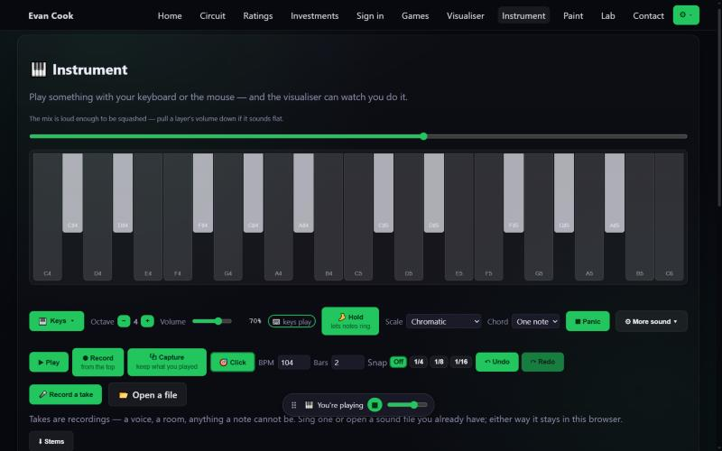           | 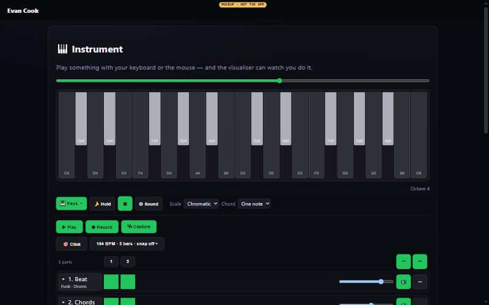           |
| 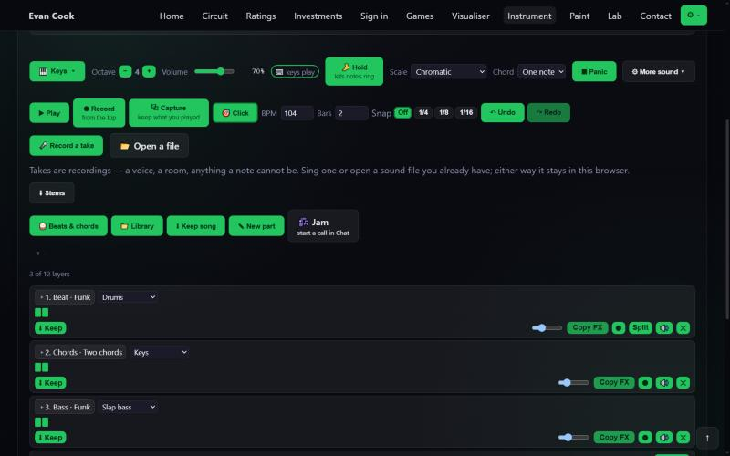 | 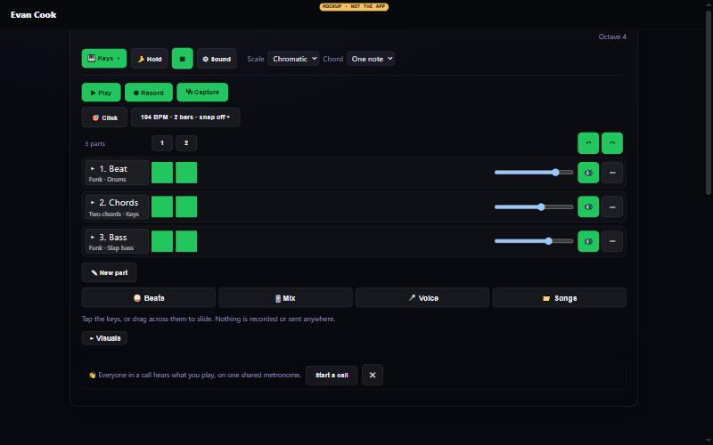 |

## Questions for Evan

1. **Drop Octave − and + from the bar,** now that the strip under the keys sets the same octave?
2. **One tool open at a time** (Beats, Mix, Voice, Songs), or several open at once as today?
3. **Speed, length and snap behind one button** that shows all three, or BPM always in view?
4. **⬇ Keep song inside 📁 Songs,** one more tap to save, or still on screen by itself?
5. **A part's volume only in Mix and its ⋯ on a phone,** with the slider on the row on a desktop?

## What building it would take

No database change and no new dependency. Every move is layout and which component draws what. It
would land as one draft per place, in order (play bar, song, tools), each checked before and after
at 375, 820 and 1440, with keyboard use and reduced motion.

## Not checked

A real phone. Firefox and Safari. The mockups were measured in the Browser pane only, and they pass
`mobileAudit` at 375 on all eight screens (after it first caught a planted 16px button).
